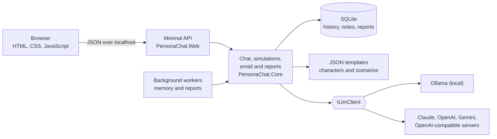

# PersonaChat

Practise everyday and workplace English by texting with fictional AI characters. PersonaChat runs on your own computer, works with a free local model through [Ollama](https://ollama.com), and is built with C# and .NET 10.

<!-- Demo GIF placeholder: add docs/demo.gif and show it here. -->

## Features

- **100 fictional characters.** Each one has a distinct personality and stays in character. Search the card grid to find someone to talk to.
- **Two conversation modes.** *Chat* is natural texting that grows from a first meeting into a friendship. *Ask* gives a structured expert answer with an example.
- **110 workplace simulations.** Role-play situations you meet at work.
- **Email wheel.** Spin for one of 100 scenarios, write the email, and get it reviewed.
- **Learning reports.** Leaving a chat, finishing a simulation or submitting an email queues a background review. Any quote the model did not copy from your own text is dropped. Reports download as PDF.
- **Memory.** Each character remembers the last 20 messages and keeps long-term notes about you. One character never sees what you told another.
- **Your choice of model.** Use a local Ollama model or a cloud provider.
- **Double-click packages.** Builds for macOS and Windows need no .NET installation. Each person's history stays on their own computer.

## Quick start

You need the [.NET 10 SDK](https://dotnet.microsoft.com/download) and [Ollama](https://ollama.com).

```bash
ollama pull gemma3:4b
```

```bash
git clone https://github.com/Yunuskngl/PersonaChat.git
```

```bash
cd PersonaChat
```

```bash
cp src/PersonaChat.Web/appsettings.example.json src/PersonaChat.Web/appsettings.json
```

```bash
dotnet run --project src/PersonaChat.Web
```

Open <http://localhost:5080>. The database is created on the first start.

## Choosing a model

Set `Llm:Provider` and the provider's `Model` in `src/PersonaChat.Web/appsettings.json`.

| `Llm:Provider` | Runs on | Needs |
| --- | --- | --- |
| `Ollama` (default) | Your computer | Ollama and a downloaded model |
| `Claude` | Anthropic API | `Llm:Claude:ApiKey` |
| `OpenAI` | OpenAI Responses API | `Llm:OpenAi:ApiKey`, `Llm:OpenAi:Model` |
| `Gemini` | Google Gemini API | `Llm:Gemini:ApiKey`, `Llm:Gemini:Model` |
| `OpenAICompatible` | Any chat/completions server, such as OpenRouter, Groq, LM Studio or LiteLLM | `Llm:OpenAiCompatible:Url`, `Llm:OpenAiCompatible:Model`, and `Llm:OpenAiCompatible:ApiKey` if the server requires one |

Keep API keys out of files. Store them with `dotnet user-secrets`:

```bash
dotnet user-secrets set "Llm:Claude:ApiKey" "<key>" --project src/PersonaChat.Web
```

With a cloud provider, your messages are sent to that provider.

## Architecture



```text
src/PersonaChat.Core/    Business logic: models, LLM clients, services, EF Core storage
src/PersonaChat.Web/     Minimal API, background workers, static web UI, templates in Data/
tests/PersonaChat.Tests/ xUnit tests with a fake ILlmClient and in-memory SQLite
packaging/               Scripts and files for the double-click builds
```

## Tests

```bash
dotnet test
```

The tests use a fake model, so they need neither Ollama nor an API key.

## Building the packages

Run this on macOS:

```bash
packaging/build.sh
```

It writes zip files for macOS (Apple Silicon and Intel) and Windows x64 to `dist/`. The packages are not signed with a paid developer certificate, so macOS and Windows may show a warning on the first start.

People who use a package still need Ollama and a model. The characters and scenarios ship inside the app and are the same for everyone. Conversations, notes and reports are stored per person:

| System | Folder |
| --- | --- |
| macOS | `~/Library/Application Support/PersonaChat` |
| Windows | `%LOCALAPPDATA%\PersonaChat` |

## Security and privacy

- The web server binds to `localhost`, with restricted `AllowedHosts` and a Content-Security-Policy.
- API keys live in user secrets or environment variables, and `appsettings.json` is git-ignored.
- User text always goes in the `user` role. Memory notes are sanitized and passed to the model as data.
- Model output is rendered as text, never as HTML.

## Built with

.NET 10, ASP.NET Core minimal APIs, EF Core with SQLite, vanilla HTML, CSS and JavaScript, xUnit, and [QuestPDF](https://www.questpdf.com) under its Community license.
